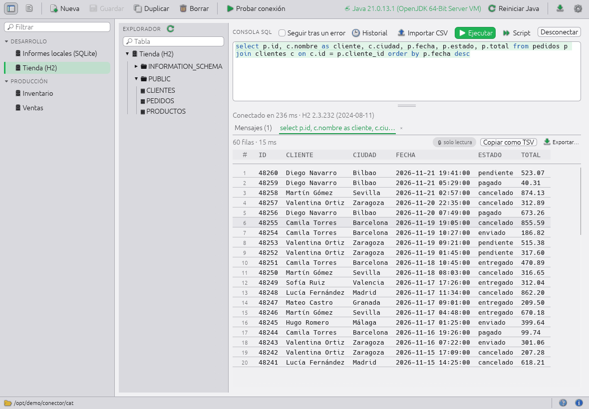
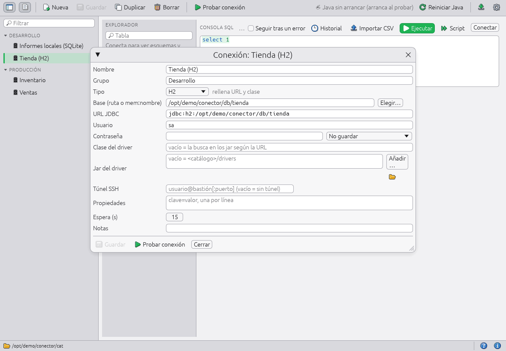

# conector

Interfaz ligera en Rust (egui/eframe) para probar conexiones JDBC, explorarlas,
guardarlas y compartirlas entre equipos y programas. Los drivers son los jar de
siempre: un pequeño proceso Java auxiliar (incrustado en el binario, 41 KB)
habla JDBC y la interfaz habla con él por stdin/stdout.

## Instalar

macOS y Linux (descarga la última versión publicada; vuelve a ejecutarlo para actualizar o
desinstalar):

    curl -fsSL https://raw.githubusercontent.com/airylp/conector/main/install.sh | sh

macOS crea `conector.app` en /Applications; Linux, `~/.local/bin/conector` con entrada en el menú.
Para compilarlo con lo último de `main`: `… | sh -s -- compilar` (instala Rust si falta).

Windows (PowerShell), o el instalador `conector-…-setup.exe` de
[Releases](https://github.com/airylp/conector/releases/latest):

    [Net.ServicePointManager]::SecurityProtocol = 'Tls12'; irm https://raw.githubusercontent.com/airylp/conector/main/install.ps1 | iex

Para actualizar: ⚙ Ajustes → «Buscar actualizaciones…» (la app avisa si hay versión nueva), o
vuelve a ejecutar el comando. Las compilaciones no están firmadas: en macOS ábrela la primera vez
con clic derecho → Abrir; en Windows, «Más información» → «Ejecutar de todas formas».

Necesita Java 8+ para los drivers. Si no hay, la app ofrece **⬇ Descargar Java
portátil** (JRE 21 de Eclipse Temurin en la carpeta de configuración).

## Uso

    conector                       interfaz
    conector --listar              id, nombre, URL
    conector --probar ID           0 si conecta (para scripts)
    conector --frase               crea o desbloquea la frase común en este equipo
    conector --clave ID            guarda la contraseña de ID cifrada en el catálogo
    conector --servir [DIR:PUERTO] servicio HTTP+JSON para otros programas

En la interfaz: clic en una conexión = conectar (el explorador muestra sus tablas),
doble clic = ver y editar sus datos. Lista agrupada (grupos plegables) con filtro, campos de servidor,
puerto y base que arman la URL (o se edita a mano), plantillas (PostgreSQL, MySQL,
MariaDB, Oracle, SQL Server, DB2, Firebird, H2, SQLite), descarga del driver
desde Maven Central (carpeta `drivers` del catálogo, se abre con 🗁), prueba en
ventana aparte con metadatos o el error completo (SQLState, causas, errores
encadenados; copiable), y explorador de esquemas → tablas: clic = DDL (la nativa
en MySQL/MariaDB, Oracle, SQLite y vistas; si no, generada con columnas, clave
primaria, foráneas, índices y comentarios), doble clic = SELECT, menú = columnas.
Español, inglés y francés.

### Consola SQL

- **Ctrl+Enter** ejecuta la selección o la sentencia del cursor (resaltada);
  **Ctrl+Mayús+Enter** / «⏩ Script», todas en orden. Separa por `;`, `/`
  (Oracle) o `GO` (SQL Server) respetando cadenas, comentarios, `$$` de
  PostgreSQL y bloques PL/SQL. Se detiene en el primer error (o sigue, si se marca).
- Un resultado por pestaña y un resumen en «Mensajes»; colores de sintaxis.
- Historial por conexión (🕘, solo en este equipo, 500 entradas).
- **Copiar**: clic en una celda copia su valor; clic en los números de fila o en
  las cabeceras selecciona filas o columnas (Mayús = rango, Ctrl = sueltas) y la
  esquina «#», todo. Ctrl+C lo copia como TSV (se pega en una hoja de cálculo).
- **Editar**, como en DBeaver: si el SELECT es de una sola tabla con clave
  primaria o índice único, clic en una celda para cambiarla (Enter guarda,
  Escape cancela; si no, el resultado sale como «🔒 solo lectura»), clic
  derecho para «Poner NULL», deshacer o copiar el valor. Los cambios de una o varias filas quedan
  en naranja; «👁 Vista previa» muestra los `UPDATE` y «✔ Aplicar» los ejecuta
  con parámetros en una transacción (si uno falla o no encuentra su fila, no se
  guarda nada).
- **Exportar** (⬇ en cada resultado) a CSV, JSON, Excel (.xlsx) o INSERT:
  lo cargado o *todo*, volviendo a ejecutar la consulta sin límite y escribiendo
  fila a fila (probado con 200 000 filas sin subir la memoria).
- **Importar CSV** (⬆, o clic derecho en una tabla del explorador): detecta el
  separador, vista previa, columnas editables, lotes de 500 filas en
  transacción con conversión al tipo de cada columna.

### Variables por equipo

En Ajustes → «Variables de este equipo» (`NOMBRE=valor`). En el catálogo
compartido, `${VAR}`, `${env:VAR}` o `${VAR:-por defecto}` en URL, usuario, jar,
propiedades y túnel: la misma conexión sirve en cada equipo con sus valores.
El formulario muestra cómo queda la URL en este equipo.

### Túneles SSH

Campo «Túnel SSH» de la conexión: `usuario@bastión[:puerto]`, clave privada
(opcional: si no, agente o `~/.ssh`), destino `host:puerto` visto desde el
bastión (vacío = el de la URL) y opciones de ssh (`-o ProxyJump=…`). Usa el
`ssh` del sistema (OpenSSH, también en Windows 10+), siempre sin pedir
contraseña. El túnel se reutiliza mientras viva y se cierra al salir.

## Catálogo compartible

Cada conexión es un archivo de texto `<catálogo>/<id>.conexion`:

    nombre=Oracle facturación
    grupo=Producción
    url=jdbc:oracle:thin:@//db-prod:1521/FACT
    usuario=lectura
    driver=oracle.jdbc.OracleDriver
    jar=drivers/ojdbc11.jar
    timeout=15
    clave_cifrada=x1:…
    prop.oracle.net.CONNECT_TIMEOUT=5000

- Pon el catálogo en una carpeta compartida (unidad de red, git, Syncthing…)
  desde Ajustes o con `CONECTOR_CATALOGO`: los demás equipos ven los cambios en
  unos 2 s. Escritura atómica y aviso si otro equipo cambió lo que editas.
- Jar relativos al catálogo; sin `jar=` se cargan todos los de
  `<catálogo>/drivers` (el catálogo lleva sus drivers).

### Contraseñas

Por conexión: **no guardar**, **solo en este equipo** (`secretos.txt` local,
permisos 600) o **compartida cifrada** en el catálogo con la *frase común* del
equipo: Argon2id (19 MiB, t=2) → clave de 256 bits, XChaCha20-Poly1305 con nonce
aleatorio. `<catálogo>/cifrado.txt` guarda sal, parámetros y un verificador,
nunca la clave. Cada equipo introduce la frase una vez (Ajustes o
`conector --frase`) y recuerda la clave derivada localmente. Cambiar la frase
vuelve a cifrar todas.

## Servicio de red

Ajustes → Servicio de red, o `conector --servir`. HTTPS + JSON con token
(`Authorization: Bearer …`):

| Método | Ruta | |
|---|---|---|
| GET | `/v1/estado` | versión, nº de conexiones, firma del catálogo |
| GET | `/v1/conexiones` | lista (sin contraseñas) |
| GET | `/v1/conexiones/{id}[?clave=1]` | una; `clave=1` solo si `servir_claves=si` |
| POST | `/v1/conexiones/{id}/probar` | prueba la conexión |
| POST | `/v1/conexiones/{id}/consulta[?max=N]` | cuerpo = SQL → columnas y filas |
| GET | `/v1/cambios?firma=F` | espera (≤25 s) a que cambie el catálogo |
| GET | `/v1/eventos` | flujo SSE: un evento `cambio` con `cambiadas`, `nuevas` y `borradas` |

Las consultas reutilizan sesiones abiertas (hasta 4 libres por conexión, se
cierran tras 5 min sin uso): la primera abre la conexión y las siguientes van
directas. Clientes de ejemplo listos para usar, solo con la biblioteca
estándar: [`ejemplos/cliente.py`](ejemplos/cliente.py) (Python 3.8+) y
[`ejemplos/Cliente.java`](ejemplos/Cliente.java) (Java 11+, `java Cliente.java lista`).

    curl --cacert servicio-cert.pem -H "Authorization: Bearer $TOKEN" https://equipo:7470/v1/conexiones
    curl --cacert servicio-cert.pem -XPOST -H "Authorization: Bearer $TOKEN" \
         --data 'select * from clientes' 'https://equipo:7470/v1/conexiones/h2/consulta?max=100'

TLS (rustls) activo por defecto. Sin certificado propio (`servir_cert=` y
`servir_clave_tls=`, PEM) se crea uno autofirmado la primera vez en la carpeta
de configuración (`servicio-cert.pem`; la clave con permisos 600), válido para
localhost, el nombre del equipo y su IP local. Los clientes confían en ese
archivo (`--cacert`) o fijan su huella SHA-256 (se muestra en Ajustes y al
arrancar `--servir`). `servir_tls=no` vuelve a HTTP en claro (solo para redes de
confianza).

## Desarrollo

    cargo test --release                       # ~38 tests
    cargo test --release descargas -- --ignored  # descargas reales (red)
    scripts/compilar-auxiliar.sh               # tras cambiar ConectorHelper.java
